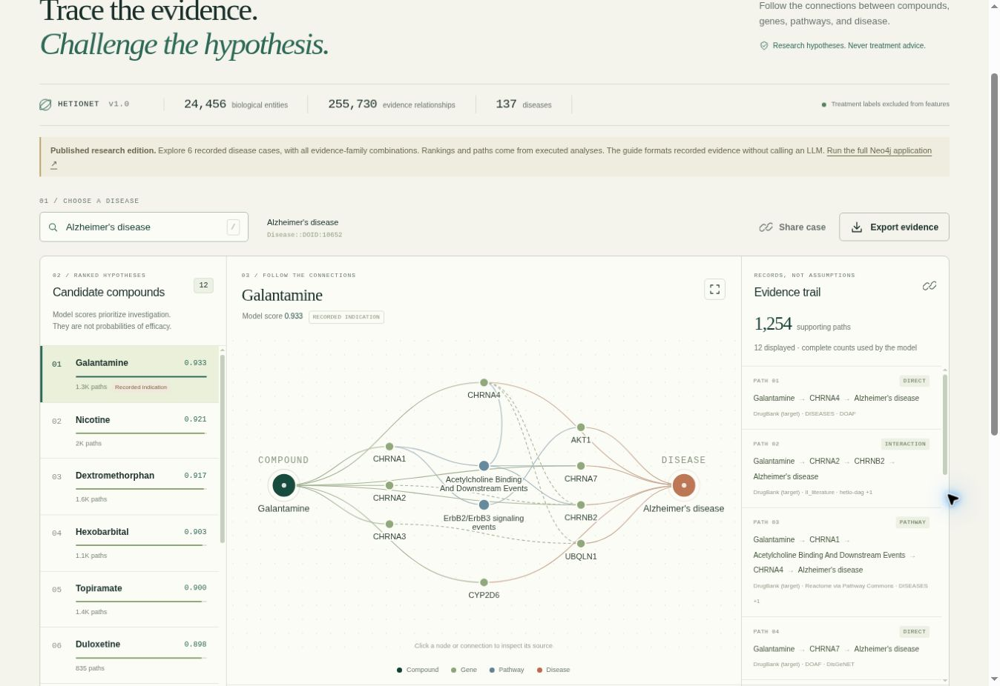
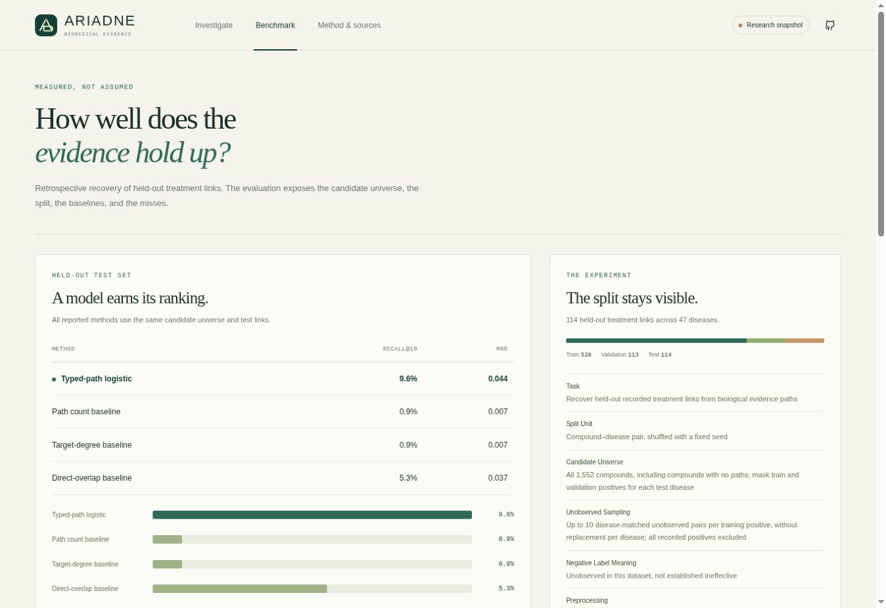
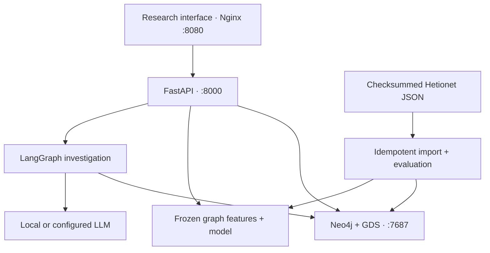

# ARIADNE

**Trace the evidence. Challenge the hypothesis.**

[](https://github.com/Azzbee/ariadne-bio/actions/workflows/ci.yml)
[](LICENSE)

ARIADNE is a biomedical evidence workbench. Choose a disease, inspect ranked
compound hypotheses, follow exact biological paths, then remove an evidence
family and see how the same model's ranking changes. An agent resolves questions,
calls bounded graph tools, and explains the returned records with an auditable
trace.

The prepared Hetionet subset contains **24,456 nodes, 255,730 evidence edges,
137 diseases and 1,552 compounds**. A separate set of 755 recorded treatment
links supports retrospective evaluation. See the checksummed
[manifest](data/processed/manifest.json) and [data sources](docs/data_sources.md).

Research hypotheses are not treatment recommendations. Removing an evidence
family measures sensitivity to the available graph, not a biological intervention.



## Run the complete application

Requires Docker with Compose v2, Git and Make. Reserve several GB of memory and
disk for Neo4j, Python packages and the optional local language model. Initial
startup downloads the checksummed dataset and model, then builds the graph.

```bash
git clone https://github.com/Azzbee/ariadne-bio.git
cd ariadne-bio
make docker-run
```

Open **http://localhost:8080**. Interactive API documentation is at
**http://localhost:8080/docs**, and Neo4j Browser is at **http://localhost:7474**.
`make init` generates a private `.env` with a random database password, preserving
existing configuration. The Neo4j username is `neo4j`.

`make docker-run` starts Neo4j 5.26.0 with GDS 2.13.4, FastAPI, Nginx, and a local
Ollama model. `make docker-core` starts the three core services with explicitly
reported deterministic agent behavior unless an external provider is configured.
For a provider, edit the `ARIADNE_LLM_*` settings in `.env`.

The browser-only research edition uses exported, frozen data and reports its
snapshot status. The complete Compose application executes live Neo4j queries
and can call a live language model. [Deployment details](docs/deployment.md).

## The demonstration

1. Select a disease and inspect a compound's direct, interaction and pathway evidence.
2. Open a node or relationship to inspect its identity and available provenance.
3. Exclude gene interactions or pathway membership. Compare ranks, scores and lost paths.
4. Ask the agent to explain the investigation. Inspect its tool trace and citations.
5. Open Evaluation to compare the model with baselines and inspect an actual failure.

The model and scaler stay fixed during challenge mode. Every evidence count is
computed over the full permitted graph; the UI displays a bounded selection of
paths and reports truncation.



## Measured benchmark

Fixed seed 42, 528 training, 113 validation and **114 held-out treatment links**.
Each test query ranks the complete compound universe after masking training and
validation positives for that disease. The language model takes no part in the
ranking or evaluation.

| Scoring method | Recall@10 | MRR | Recovered / 114 |
| --- | ---: | ---: | ---: |
| Typed-path logistic model | 0.0965 | 0.0439 | 11 |
| Direct-overlap baseline | 0.0526 | 0.0365 | 6 |
| Target-degree baseline | 0.0088 | 0.0072 | 1 |
| Total-path-count baseline | 0.0088 | 0.0069 | 1 |

These are modest retrospective retrieval results, not clinical efficacy estimates
or evidence of new drug discovery. The benchmark is transductive and uses
unobserved pairs as sampled training negatives, with their meaning explicitly
limited to absence from this dataset. Full protocol, split identities, coefficients,
ablation results and failure examples are in
[evaluation.json](data/processed/evaluation.json), [model.json](data/processed/model.json)
and the [model card](docs/model_card.md).

## Reproduce and verify

```bash
make install          # Python 3.11+; the verified reference runtime is Python 3.12
make data             # Download, checksum, prepare, train and evaluate
make test             # Unit/API tests, branch coverage gate and frontend tests
make lint             # Pylint >=9.5 and Black formatting
make notebook         # Execute every notebook cell with the active interpreter
make smoke            # Exercise the live HTTP workflow on port 8080
make test-integration # Genuine Neo4j/Cypher/GDS tests; see deployment instructions
make test-llm         # Actual provider investigation, challenge routing and rejection
```

The reference build passed **103 Python tests, 29 frontend tests, 8 genuine
Neo4j/GDS integration tests and 3 actual local-LLM HTTP tests**. A separate clean
Python environment installed the hash-locked dependencies without system packages,
passed the tests at **83.58% branch-aware coverage**, and executed every notebook
cell. The full source passed **Pylint 10.00/10** and Black. See
[fresh-environment evidence](reports/fresh-environment.json),
[database test results](reports/neo4j-junit.xml) and
[actual LLM test results](reports/llm-junit.xml).

Measured query plans reduced database hits from **48,913 to 2** for an equivalent
identity lookup. Warm local timings and complete PROFILE plans are retained in
[query optimization evidence](reports/query_optimization.json). These timings
describe the measured machine, not a production performance guarantee.

The CI workflow repeats these checks, starts Compose from a fresh checkout, and
publishes API and frontend images only after quality and integration jobs pass.
The workflow badge above reports its actual status. Registry locations:
[API image](https://github.com/Azzbee/ariadne-bio/pkgs/container/ariadne-bio-api)
and [frontend image](https://github.com/Azzbee/ariadne-bio/pkgs/container/ariadne-bio-frontend).
Publication and public pull availability must be verified in the release evidence.

## Architecture



Neo4j stores typed, namespace-qualified entities and provenance. Sparse feature
matrices support reproducible full-candidate ranking. GDS exposes graph proximity
and compound target similarity as separate analysis tools. The agent explains
structured tool results and never provides benchmark labels or model scores.

## API examples

```bash
curl 'http://localhost:8080/api/diseases?q=asthma'
curl 'http://localhost:8080/api/rankings/Disease::DOID:2841?limit=5'
curl 'http://localhost:8080/api/evidence/Disease::DOID:2841/Compound::DB00961?limit=8'
curl -X POST 'http://localhost:8080/api/challenge' \
  -H 'Content-Type: application/json' \
  -d '{"disease_id":"Disease::DOID:2841","exclude":["INTERACTS"],"limit":5}'
curl -X POST 'http://localhost:8080/api/agent' \
  -H 'Content-Type: application/json' \
  -d '{"question":"Explain the evidence for asthma","disease_id":"Disease::DOID:2841"}'
```

## Documentation

| Question | Document |
| --- | --- |
| How is the graph modeled? | [Architecture and schema](docs/architecture.md) |
| Why these choices instead of a generic generated graph? | [Anti-genericity appendix](docs/anti_genericity.md) |
| How are leakage, candidates and failure cases handled? | [Model card](docs/model_card.md) |
| Where did the data come from, and under what terms? | [Data sources and licenses](docs/data_sources.md) |
| How do I run, configure and troubleshoot it? | [Deployment](docs/deployment.md) |
| What does each grading criterion map to? | [Rubric evidence matrix](docs/rubric.md) |
| What should the recorded demonstration show? | [Nine-minute walkthrough](docs/demo_script.md) |
| What was automated and who contributed? | [Authorship and AI assistance](docs/authorship.md) |

The source code is [MIT licensed](LICENSE). Dataset source licenses remain with
their respective owners. The original Hetionet paper is
[Himmelstein et al., eLife 2017](https://doi.org/10.7554/eLife.26726).
