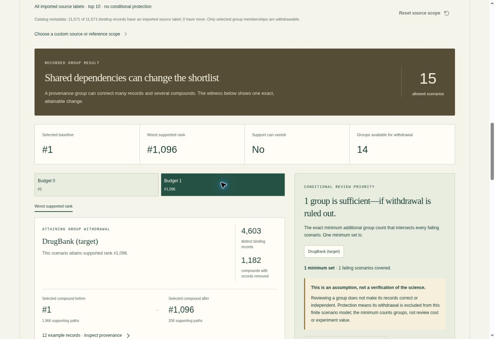
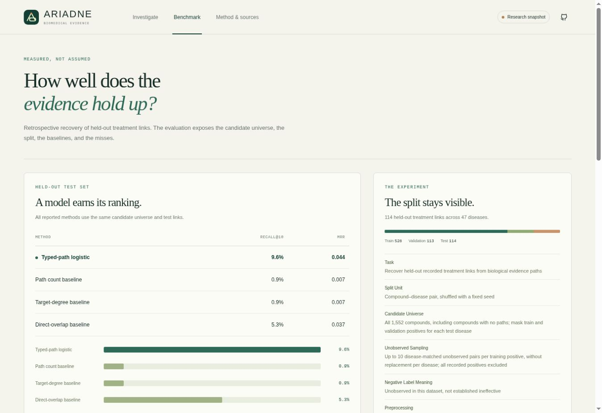
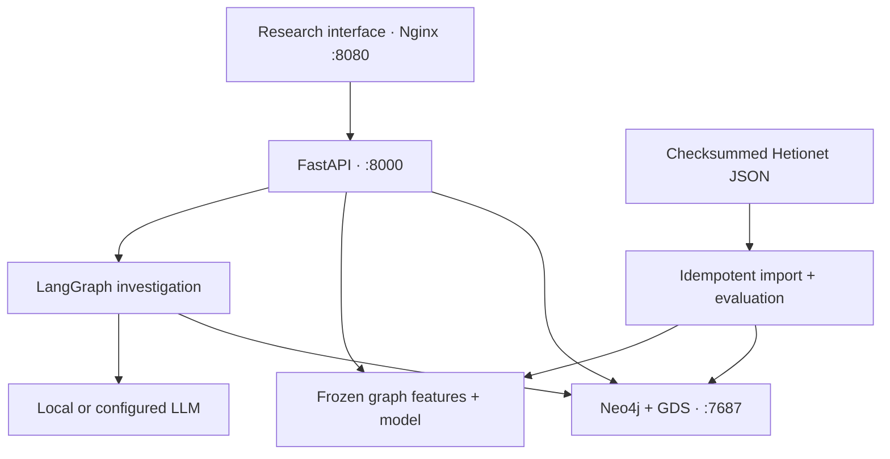

# ARIADNE


**Follow the evidence. Find what holds.**

[](https://github.com/Azzbee/ariadne-bio/actions/workflows/ci.yml)
[](LICENSE)

ARIADNE helps researchers explore medicines that might be worth investigating
for another disease, inspect the biological evidence behind each suggestion,
and test which suggestions survive changes to that evidence. Its workbench
combines a knowledge graph, a fixed ranking model, a bounded research agent and
exact, replayable evidence audits.

**Version 1.4 adds an evidence-atlas landing page and a joint evidence audit.**
The new threaded logo, animated conceptual map and interactive recorded example
introduce the research question before opening the full workbench. The landing
page loads without fetching the graph dataset; existing case links still open
their selected investigation directly. See the [design notes](docs/design.md).

The research addition closes a logical gap: surviving a source-group test and
an individual-record test separately does not establish survival when both
changes occur together. The joint auditor conditions on each selected group
withdrawal, then computes the exact effect of one additional surviving binding
record anywhere in the graph, including a competitor's. Its four-cell frontier
separates worse supported ranks from complete loss of support. See the
[joint-audit guide](docs/mixed_audit.md), [proof](docs/mixed_audit_proof.md), and
[research position and prior art](docs/research_atlas.md).

| Audit | Declared withdrawal space | Result |
| --- | --- | --- |
| Individual records | Any zero, one or two BINDS records across all compounds | Exact worst supported rank, support loss and attaining witnesses |
| Shared provenance | Any zero, one or two selected source or PubMed annotation groups | Exact joint reranking, shared dependencies and minimum conditional protection sets |
| Joint evidence | Up to one selected annotation group plus one additional surviving BINDS record | Exact two-axis frontier and witnesses for simultaneous changes |

Group budgets and record budgets count different units. All three methods keep
the fitted model fixed, include every competing compound, state their finite
scope, and provide separately callable verification. These guarantees concern
the specified ranking function; they do not establish clinical efficacy,
biological causality or source independence. A protection set is an explicit
assumption about unavailable withdrawals, not evidence that a review proves
records true.

The prepared Hetionet subset contains **24,456 nodes, 255,730 evidence edges,
137 diseases and 1,552 compounds**. A separate set of 755 recorded treatment
links supports retrospective evaluation. See the checksummed
[manifest](data/processed/manifest.json) and [data sources](docs/data_sources.md).

Research hypotheses are not treatment recommendations. Removing an evidence
family measures sensitivity to the available graph, not a biological intervention.


## Inspect the published research edition

[Download the standalone research edition](https://github.com/Azzbee/ariadne-bio/releases/latest)
from the release assets. Extract `ariadne-research-edition.zip`, run
`python3 -m http.server 8080 --bind 127.0.0.1` inside it, and open
http://localhost:8080. It needs no Docker, API key or model download. Its recorded
results and deterministic guide are explicitly identified. The v1.4 source
packages all three audit methods, conditional protection plans, complete
certificates, printable group-review dossiers, proofs, the executed notebook,
measured benchmarks and checksums.
The separate verification archive retains the actual run identities and replay
evidence. Any accompanying narrated video and captions are explicitly labeled as
the historical v1.1 walkthrough; they do not demonstrate the newer audit features.

## Run the complete application

Requires Docker with Compose v2, Git, Make and Python 3 (for initial credential
generation). A practical local budget is 8 GB available RAM and 20 GB free disk;
the verified reference CI runner has 16 GB RAM. The pinned Ollama image alone has
about 3.4 GB of compressed layers, before extraction, and the default model is
about 1 GB. Initial startup prepares the checksummed dataset and verifies the
local model's full manifest digest before starting the application.

```bash
git clone https://github.com/Azzbee/ariadne-bio.git
cd ariadne-bio
make docker-run
```

For an existing v1.2 volume, stop the old project with `make docker-stop`, then
run `make docker-run COMPOSE='docker compose -p ariadne-v13'`. Version 1.3 requires
a completed prepared-graph identity; the new project preserves the old volumes
and creates an isolated import. [Upgrade details](docs/deployment.md#prepared-graph-identity-and-existing-volumes).

Open **http://localhost:8080**. Interactive API documentation is at
**http://localhost:8080/docs**, and Neo4j Browser is at **http://localhost:7474**.
`make init` generates a private `.env` with a random database password, preserving
existing configuration. The Neo4j username is `neo4j`.

`make docker-run` starts Neo4j 5.26.0 with GDS 2.13.4, FastAPI, Nginx, and a local
Ollama model. `make docker-core` starts the three core services with explicitly
reported deterministic agent behavior unless an external provider is configured.
For a provider, edit the `ARIADNE_LLM_*` settings in `.env`.

The browser-only research edition uses exported, frozen data and reports its
snapshot status. The complete Compose application executes live Neo4j queries
and can call a live language model. [Deployment details](docs/deployment.md).

## The demonstration

1. Select a disease and inspect a compound's direct, interaction and pathway evidence.
2. Open a node or relationship to inspect its identity and available provenance.
3. Exclude gene interactions or pathway membership. Compare ranks, scores and lost paths.
4. Ask the agent to explain the investigation. Inspect its tool trace and citations.
5. Run the binding audit, inspect a worst-case witness and verify its certificate.
6. Audit provider or citation groups, inspect shared records and compare conditional protection sets.
7. Open the joint audit to compare the baseline, each separate operation, and their combination.
8. Open Benchmark to compare the model with baselines and inspect an actual failure.

Version 1.1 keeps the selected compound visible when evidence changes, even when
it falls outside the displayed ranking or loses every supporting path. Its
assessment shows the all-evidence baseline beside the selected scenario, with
exact signed feature contributions that reconstruct both scores. Ask about a
named compound and the agent focuses its evidence and assessment on that compound
while retaining the correctly ordered ranking as context.

The model and scaler stay fixed during challenge mode. Contributions add in
**logit space**, relative to the saved training-feature means; they are not causal
attributions or clinical probabilities. A pair with no surviving paths has no
supported rank; its finite model output is labeled diagnostic. Every evidence
count uses the full permitted graph; displayed paths are bounded and truncation
is reported. See the [model card](docs/model_card.md) and [API contract](docs/api.md).

The binding audit always starts from the complete graph, independently of the
family-exclusion controls. New certificates declare `decimal80-binary64-v1`,
which applies the same fitted parameters through a specified decimal/binary64
arithmetic contract. The explorer retains its existing scorer. Historical
`float64-fixed-order-v1` certificates retain their original identity and any
recorded explorer comparisons; new certificates omit those runtime-dependent
comparison fields. Exact verification always uses the certificate's declared scorer.
It considers all 1,552 compounds as competitors. At budget two, 117,147 local
states cover 66,949,807 possible global deletion subsets by a separability proof;
these are state counts, not a measured runtime speedup. A witness proves that a
rank can occur. Verification also recomputes the bound, because one witness alone
cannot establish optimality.

The complete audit benchmark covers all 137 diseases and 1,330 baseline top-ten
queries. At budget two, 104 remain certified robust and 1,226 are fragile. A
strong margin-aware greedy comparator finds every one of those failures but
underestimates 19 worst supported ranks. The result supports exact certification;
it does not show extra top-ten failure discovery over that stronger heuristic.
The [complete protocol and results](docs/audit_benchmark.md) retain both greedy
comparators, scope differences, numerical identities and actual replay checks.

### A dependency that individual-record tests cannot expose

In the frozen research example, **Marimastat / rheumatoid arthritis stays first
under any two individual binding-record withdrawals**. Quarantining all records
annotated with the DrugBank target source group permits **rank 1,096**. That single
group removes 4,603 binding records across 1,182 compounds, so every affected rival
must be rescored too. The two guarantees cover different withdrawal spaces.

The group audit shows the attaining records, the original shortlist's changed
ranks and the smallest additional group-protection assumptions that block every
failure. Its [complete certificate](reports/v1.3.0/provenance-audit-example-source.json)
can be recomputed independently. This is a postselected sensitivity illustration,
not a treatment claim or evidence that the source is unreliable.





### Measured joint-audit results

The completed [v1.4 reference workload](reports/v1.4.0/mixed-audit-summary.json)
covers **1,330 baseline top-ten queries
across all 137 diseases**; three diseases have no supported candidates. Every
query keeps the same fitted model and reranks all 1,552 compounds. The group
scope contains all 14 observed source labels, with at most one withdrawn group
and one additional surviving binding record.

| Group budget | Additional-record budget | Top-ten robust / 1,330 | Support loss attainable / 1,330 |
| ---: | ---: | ---: | ---: |
| 0 | 0 | 1,330 | 0 |
| 0 | 1 | 256 | 79 |
| 1 | 0 | 39 | 205 |
| 1 | 1 | **0** | 375 |

**Thirty queries pass both separate audits, and all thirty fail the joint audit.**
Separate passes therefore do not establish joint robustness. The strongest
result from both greedy operation orders finds 1,326 of the 1,330 failures;
the exact audit finds the remaining **four**. That greedy comparator
underestimates the worst supported rank in **54 of 966** supported outcomes,
with a maximum gap of 867 positions. The other 364 outcomes have no support and are
excluded from that rank-gap denominator.

All 1,330 certificates verified, with 5,560 certificate witness replays and
2,455 greedy witness replays and no failed checks. These findings concern one
graph, one fitted model and the declared withdrawal space. The
[complete results](docs/mixed_audit_results.md) and
[full report](reports/v1.4.0/mixed-audit-benchmark.json) retain the scope,
comparators, postselected illustration and actual execution identities.

A separate **24-graph synthetic study** ran 72 matched trials with cold
arithmetic caches. Across its eight size/group settings, the literal exhaustive
reference took **10.9–71.0×** as long as the envelope method for setup and solving
(median paired ratios per setting). These are measured times on a
small synthetic family and one runtime; they do not establish Hetionet-scale
latency. The [scaling protocol and results](docs/mixed_scaling.md) retain every
trial, generated input and comparison boundary.

## Retrospective retrieval benchmark

Fixed seed 42, 528 training, 113 validation and **114 held-out treatment links**.
Each test query ranks the complete compound universe after masking training and
validation positives for that disease. The language model takes no part in the
ranking or evaluation.

| Scoring method | Recall@10 | MRR | Recovered / 114 |
| --- | ---: | ---: | ---: |
| Typed-path logistic model | 0.0965 | 0.0439 | 11 |
| Direct-overlap baseline | 0.0526 | 0.0365 | 6 |
| Target-degree baseline | 0.0088 | 0.0072 | 1 |
| Total-path-count baseline | 0.0088 | 0.0069 | 1 |

These are modest retrospective retrieval results, not clinical efficacy estimates
or evidence of new drug discovery. The benchmark is transductive and uses
unobserved pairs as sampled training negatives, with their meaning explicitly
limited to absence from this dataset. Full protocol, split identities, coefficients,
ablation results and failure examples are in
[evaluation.json](data/processed/evaluation.json), [model.json](data/processed/model.json)
and the [model card](docs/model_card.md).

## Reproduce and verify

Native development requires Python 3.11+ (3.12 is the tested reference), Node.js
18+ (CI uses 22), Make and Git. Node runs the dependency-free frontend tests;
`make install` installs the Python environment. Generate the snapshot before
running tests to include all seven recorded cases and all sixteen exclusion sets.

```bash
make install          # Python 3.11+; the verified reference runtime is Python 3.12
make data             # Download, checksum, prepare, train and evaluate
make snapshot         # Export every recorded scenario for frontend verification
make audit-licenses   # Inventory actual source-license text and missing metadata
make benchmark-audits # All diseases, top ten, global binding budgets zero to two
make benchmark-provenance # All diseases, correlated source groups and protection sets
make benchmark-mixed  # All diseases, joint source/record frontier and both greedy orders
make benchmark-mixed-scaling # Matched synthetic timing against exhaustive recomputation
make provenance-controls # Disclosed size-matched controls for two selected examples
make test             # Unit/API tests, branch coverage gate and frontend tests
make lint             # Pylint >=9.5 and Black formatting
make notebook         # Execute every notebook cell with the active interpreter
make verify-scores    # Full legacy score parity; requires the v1.0 Git history
make smoke            # Live HTTP workflow, certificate replay and tamper rejection
make test-integration # Genuine Neo4j/Cypher/GDS tests; see deployment instructions
make test-llm         # Actual provider investigation, challenge routing and rejection
```

Version 1.1 historical verification and interface changes are recorded in the
[1.1 verification notes](docs/releases/v1.1.0.md). The v1.2
[audit methodology](docs/research_contribution.md) describes its additional gates
and bounded claims. The workflow badge
links to actual CI status; configured checks alone are not a successful run.

The published **1.0 historical reference** passed **103 Python tests, 29 frontend tests, 8 genuine
Neo4j/GDS integration tests and 3 actual local-LLM HTTP tests**. A separate clean
Python environment installed the hash-locked dependencies without system packages,
passed the tests at **83.58% branch-aware coverage**, and executed every notebook
cell. The 1.0 source passed **Pylint 10.00/10** and Black. Its immutable evidence:
[fresh-environment evidence](https://github.com/Azzbee/ariadne-bio/blob/v1.0.0/reports/fresh-environment.json),
[database test results](https://github.com/Azzbee/ariadne-bio/blob/v1.0.0/reports/neo4j-junit.xml) and
[actual LLM test results](https://github.com/Azzbee/ariadne-bio/blob/v1.0.0/reports/llm-junit.xml).

Measured query plans reduced database hits from **48,913 to 2** for an equivalent
identity lookup. Warm local timings and complete PROFILE plans are retained in
[query optimization evidence](reports/query_optimization.json). These timings
describe the measured machine, not a production performance guarantee.

The current CI workflow is configured to verify selected-compound assessment,
exact score reconstruction, retained unsupported pairs, frontend response headers,
the full-dataset binding audit, rejected rehashed certificate claims, and a live
LLM request that overrides stale compound selection. It deletes old
operational reports before collecting fresh evidence for the actual checkout,
records the default model identity, and publishes API and frontend images only
after quality, full-stack integration and the separate joint-audit research job
pass for the same revision. Each job retains its own fitted model; identical
seeds do not justify substituting one job's parameters for another's. Release proof is tied to the
verified source commit; [release instructions](docs/releasing.md) describe it.
The workflow badge above reports its actual status. Registry locations:
[API image](https://github.com/Azzbee/ariadne-bio/pkgs/container/ariadne-bio-api)
and [frontend image](https://github.com/Azzbee/ariadne-bio/pkgs/container/ariadne-bio-frontend).
The published release includes anonymous manifest, configuration and layer-byte
verification. Repeat that verification for each release commit.

## Architecture



Neo4j stores typed, namespace-qualified entities and provenance. Sparse feature
matrices support reproducible full-candidate ranking. GDS exposes graph proximity
and compound target similarity as separate analysis tools. The agent explains
structured tool results. The language model never determines benchmark labels or
model scores; those come from the recorded data and deterministic graph pipeline.

For an exported binding, provenance or joint certificate, the offline verifier needs no running API,
Neo4j or language model:

```bash
.venv/bin/python -m scripts.verify_audit binding-audit.json \
  --data-dir data/processed --output audit-verification.json
```

It checks the full claims and replays the witnesses against the matching local
graph/model identities. Exit zero means verified; exit one means invalid.

## API examples

```bash
curl 'http://localhost:8080/api/diseases?q=asthma'
curl 'http://localhost:8080/api/rankings/Disease::DOID:2841?limit=5'
curl 'http://localhost:8080/api/evidence/Disease::DOID:2841/Compound::DB00961?limit=8'
curl 'http://localhost:8080/api/assessment/Disease::DOID:10652/Compound::DB00184?exclude=INTERACTS'
curl -X POST 'http://localhost:8080/api/challenge' \
  -H 'Content-Type: application/json' \
  -d '{"disease_id":"Disease::DOID:2841","exclude":["INTERACTS"],"limit":5}'
curl -X POST 'http://localhost:8080/api/agent' \
  -H 'Content-Type: application/json' \
  -d '{"question":"Explain Nicotine for Alzheimer disease","disease_id":"Disease::DOID:10652","compound_id":"Compound::DB00184","exclude":["INTERACTS"]}'
```

## Documentation

| Question | Document |
| --- | --- |
| How is the graph modeled? | [Architecture and schema](docs/architecture.md) |
| Why these choices instead of a generic generated graph? | [Anti-genericity appendix](docs/anti_genericity.md) |
| What is the new research claim, and what already exists? | [Contribution and prior art](docs/research_contribution.md) |
| What exactly does the ranking certificate prove? | [Binding-audit proof and numerical contract](docs/binding_audit_proof.md) |
| How do shared-source withdrawals and conditional protection work? | [Provenance audit guide](docs/provenance_audit.md) and [proof](docs/provenance_audit_proof.md) |
| What happens when source and individual-record changes occur together? | [Joint-audit guide](docs/mixed_audit.md), [proof](docs/mixed_audit_proof.md) and [research position](docs/research_atlas.md) |
| How is the solver's runtime compared fairly? | [Synthetic scaling protocol and measured-time conventions](docs/mixed_scaling.md) |
| How are certificate calculations reproduced across machines? | [Declared numerical contract](docs/audit_numerical_contract.md) |
| What did the individual-record audit and stronger baseline find? | [Audit benchmark and limitations](docs/audit_benchmark.md) |
| What did the complete joint audit and greedy comparisons find? | [Measured joint-audit results](docs/mixed_audit_results.md) |
| How are leakage, candidates and failure cases handled? | [Model card](docs/model_card.md) |
| Where did the data come from, and under what terms? | [Data sources and licenses](docs/data_sources.md) |
| Which license restrictions and gaps are actually recorded? | [Observed license inventory](docs/licensing_audit.md) |
| How would commercial value be tested? | [Prospective pilot protocol](docs/commercial_pilot.md) |
| What does each API response mean? | [API contract and examples](docs/api.md) |
| How does the interface introduce the research question? | [Brand, interaction and accessibility notes](docs/design.md) |
| How do I release a tested source revision? | [Release verification](docs/releasing.md) |
| How do I run, configure and troubleshoot it? | [Deployment](docs/deployment.md) |
| What does each grading criterion map to? | [Rubric evidence matrix](docs/rubric.md) |
| What should the recorded demonstration show? | [Nine-minute walkthrough](docs/demo_script.md) |
| What was automated and who contributed? | [Authorship and AI assistance](docs/authorship.md) |

The source code is [MIT licensed](LICENSE). Dataset source licenses remain with
their respective owners. This research dataset is not presented as commercially
cleared; the license inventory records noncommercial declarations and missing
terms, without making automated legal decisions. The original Hetionet paper is
[Himmelstein et al., eLife 2017](https://doi.org/10.7554/eLife.26726).
