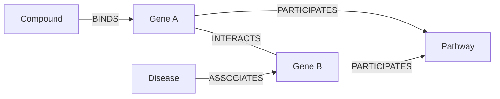
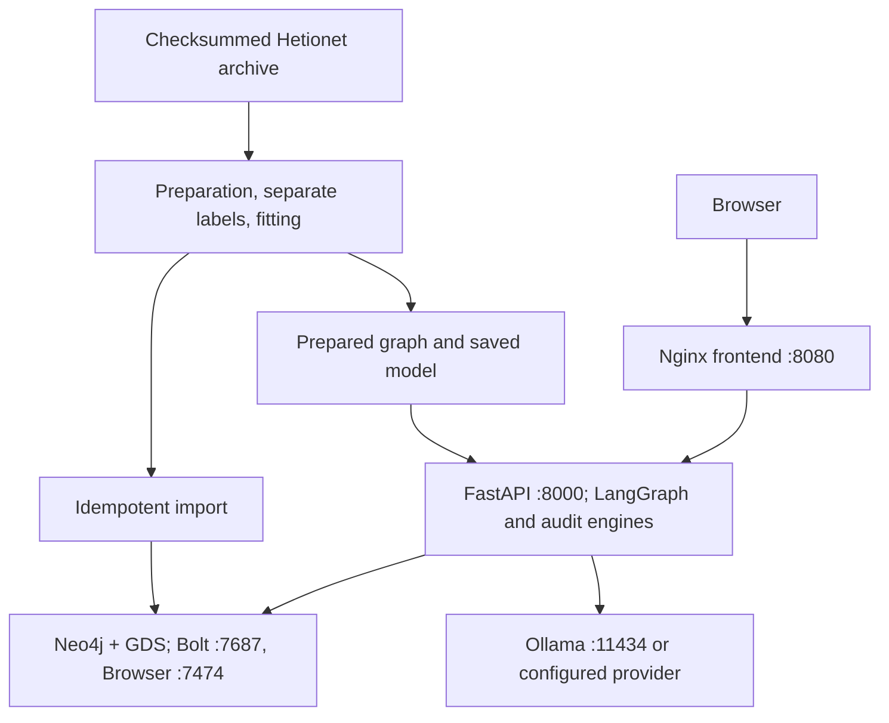
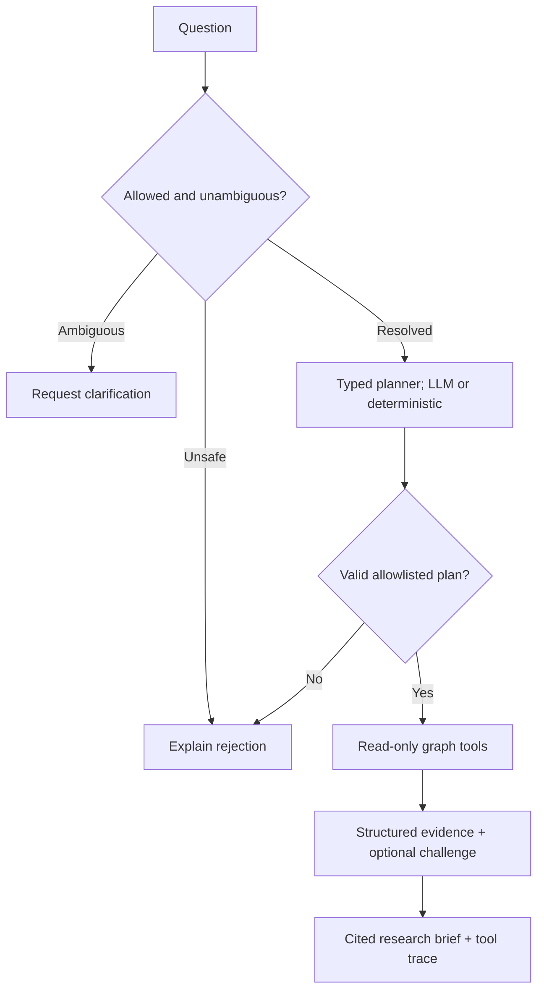

# Architecture and graph schema

## Biological evidence model

All biological nodes also carry a shared entity identity. A `Gene` in Hetionet
represents the corresponding gene/protein concept used by its integrated sources.
`Compound–BINDS–Gene` therefore records binding to the protein encoded by that
gene, rather than claiming that small molecules bind DNA in every such record.

| Entity | Identifier policy | Imported count |
| --- | --- | ---: |
| Compound | `Compound::` plus the original DrugBank identifier | 1,552 |
| Gene | `Gene::` plus the original Entrez Gene identifier | 20,945 |
| Disease | `Disease::` plus the original Disease Ontology identifier | 137 |
| Pathway | `Pathway::` plus the original source identifier | 1,822 |

| Evidence relation | Stored endpoints | Imported count |
| --- | --- | ---: |
| BINDS | Compound → Gene | 11,571 |
| ASSOCIATES | Disease → Gene | 12,623 |
| INTERACTS | Gene → Gene, traversed symmetrically | 147,164 |
| PARTICIPATES | Gene → Pathway | 84,372 |

Counts are recorded in the [manifest](../data/processed/manifest.json). Identity
is never based on a human-readable name. Original attributes, source fields and
available licenses survive preprocessing. A displayed edge ID points to the
retained source record. Missing publication-level citations remain missing;
database provenance is not promoted into a claim of a specific clinical study.

### Properties, constraints and indexes

The [preprocessor](../scripts/prepare_data.py) defines the retained records;
the [Neo4j importer](../app/neo4j_repository.py) creates the following schema.
Nested upstream metadata is serialized as JSON when stored in Neo4j, so it is
retained without pretending every source shares a uniform set of properties.

| Record | Properties and role |
| --- | --- |
| `Entity:Compound`, `Entity:Gene`, `Entity:Disease`, `Entity:Pathway` | `id` is the namespace-qualified key; `identifier` preserves the source ID; `name` is a display/search field; `url` and original `data` are retained when available. |
| `BINDS`, `ASSOCIATES`, `INTERACTS`, `PARTICIPATES` | Stable `id`, relation `type`, original `direction`, normalized `sources`, available `license` and original `data`; typed start/end nodes carry the prepared source/target identities. |
| `Dataset` | One import marker with `id`, source archive `sha256`, prepared `graph_sha256`, `import_status`, `nodes` and `edges`. It records a completed import and is excluded from biological node counts. |

| Database rule | Reason |
| --- | --- |
| Unique `id` on `Entity` | One identity across every biological label; prevents cross-label collisions. |
| Unique `id` on each of `Compound`, `Gene`, `Disease`, `Pathway` | Domain-specific query anchors and idempotent imports. |
| Unique `id` on `Dataset` | One marker for the pinned dataset generation. |
| Name indexes on `Disease.name` and `Compound.name` | Declared indexes for domain name lookups; name remains separate from identity. |

Uniqueness constraints also provide their backing indexes. The measured
[optimization report](../reports/query_optimization.json) compares an indexed
identity lookup with an equivalent unanchored scan; it does not claim that a
name index accelerates every possible text-search predicate. Batched ingestion
uses parameterized `UNWIND` and `MERGE`, then verifies inventory counts before
marking the import complete.

The 755 known treatment pairs are a separate label table. Neither `TREATS` nor
`PALLIATES` participates in predictive features, GDS evidence projections or
displayed biological evidence paths. A known-treatment badge is a factual lookup
against that separate table.

## Three path templates

| Template | Meaning | Maximum length |
| --- | --- | ---: |
| C–G–D | Compound and disease share a gene | 2 edges |
| C–G–G–D | Target and disease-associated gene interact | 3 edges |
| C–G–P–G–D | Distinct target and disease-associated genes share a pathway | 4 edges |

Sparse matrix products count these paths exactly. The pathway count explicitly
excludes the case where both gene positions are the same node. No self-loop
interaction contributes an artificial extra step. Display limits bound graph
visualization and query results without clipping model features.

## Runtime responsibilities

| Component | Responsibility |
| --- | --- |
| Nginx | Serve the interface, reverse-proxy API and documentation, bound request sizes |
| FastAPI | Validate inputs and outputs, enforce limits, expose structured errors |
| Neo4j | Store and query typed evidence with constraints and indexes |
| GDS | Project evidence and compute personalized PageRank and target-neighborhood similarity |
| Graph engine | Compute exact typed-path features, apply the saved model and reconstruct selected-pair scores from its signed terms |
| Binding auditor | Enumerate local binding-deletion envelopes, allocate a global budget across focus and competitors, and return exact bounded ranking certificates |
| Provenance auditor | Enumerate correlated provider/citation withdrawals, score all compounds jointly, and compute exact conditional protection sets |
| Joint auditor | Condition on each allowed group withdrawal, then certify one additional surviving binding-record deletion across all compounds; return the complete two-axis frontier |
| LangGraph | Orchestrate entity resolution, retrieval, comparison and explanation |
| LLM provider | Parse the research request into a validated, typed investigation plan |
| Evaluation script | Fix the split, fit preprocessing/model on permitted data and write measured metrics |

## Services, ports and data flow

Nginx proxies `/api` and `/docs`; FastAPI owns validation and orchestration.
The published development ports bind to `127.0.0.1`. Ollama's port is internal
to Compose. `make docker-run` also runs a one-shot model bootstrap, verifies
the model manifest and enables the local provider connection. `make docker-core`
uses deterministic planning unless a provider URL is configured. A completed
response's `mode` records the execution that occurred; rejected requests also
report the attempted workflow and reason in their trace. Configured `auto`
policy alone is not evidence of a successful LLM request.

## Data flow and reproducibility

The source URL pins a Git commit. The downloader rejects bytes with a mismatched
SHA-256. Preprocessing filters the four node and relationship families, saves the
graph and manifest, and keeps treatment labels separately. Evaluation stores the
actual split identities, selected hyperparameter, model parameters and scores.

The API reports which backend produced its results. A memory engine is useful
for deterministic unit tests and local exploration. The full Compose configuration
uses Neo4j. The exported browser edition identifies its precomputed snapshot and
does not claim to execute live Neo4j or language-model requests.

## Agent control flow

The LLM cannot alter the database, choose benchmark labels or replace model
scores. Query identifiers and relationship choices pass explicit validation.
Relationships are allowlisted, values parameterized, result sizes bounded and
database execution timed out. Status, mode and trace expose provider failures
and any deterministic fallback instead of claiming a successful LLM invocation.

Input rejection and provider-output validation are distinct boundaries. The
planner accepts only `investigate` or `challenge`, allowlisted relation
exclusions and a result limit from one to ten. Extra fields, arbitrary Cypher,
invalid actions and malformed JSON fail validation. The
[provider-output fault-injection test](../tests/test_agent.py) supplies seven
invalid responses and asserts rejection before ranking executes. This is a
controlled test of bad model output, separate from the
[live-provider HTTP checks](../tests/test_llm_live.py).

A question can include a disease and a compound independently. A single explicit
compound name overrides an old UI compound selection; multiple names require
clarification. The focused compound determines the evidence paths and exact
assessment. The accompanying candidate list remains the ordered top-K ranking,
so explanatory focus never rewrites the ranked result.

An assessment is computed directly from the graph engine's saved feature
transformations, scaler and coefficients. Baseline and current contributions
reconstruct their respective logits, and the sigmoid reconstructs their scores.
Unsupported pairs retain a diagnostic assessment with no supported rank. The
static exporter records these same assessment objects; it does not approximate
or recompute them in browser JavaScript.

## Binding-audit computation

The auditor snapshots the fitted model, evidence matrices, entity metadata,
disease positions and original path counts when first needed. It validates the
record identities, preserves compound-ID tie ordering, and uses the explicit
[`decimal80-binary64-v1` numerical contract](audit_numerical_contract.md).
Precision-80 Decimal transforms and separately ordered nearest-even binary64
operations make the sealed finite function independent of dispatched NumPy
transcendentals. The earlier vectorized ranking and assessment calculations
remain unchanged. Historical scorer identities select their original strict
verifier and a captured legacy score matrix; new certificates omit those
platform-dependent comparison fields.

For a disease, a bounded cache holds local supported score minima/maxima at
deletion counts zero, one and two. The selected compound's minimum score sets a
threshold; each competitor's maximum envelope yields the least cost required to
outrank it. Since binding edge sets are disjoint across compounds, choosing the
cheapest competitor promotions within the remaining global budget is exact.
Loss of support is a separate outcome. The [proof](binding_audit_proof.md) gives
the conditions and attaining-witness construction.

The API and offline verifier recompute the same-algorithm bound in a separate
bounded cache, then independently replay witnesses using edited graph matrices.
The static exporter stores certificates and export-time verification; JavaScript
does not pretend to rerun the optimizer. The scientific tests compare the method
with exhaustive global enumeration on independent tiny graphs.

## Correlated provenance audit

The v1.3 catalogue indexes the observed provider labels and imported PubMed
identifiers on BINDS records. Each selected group maps to an explicit set of
edge IDs; overlapping groups remove the union once. The index and source bytes
are bound into the certificate. Missing annotations remain outside group-based
withdrawals and are exposed as coverage, never invented.

A selected group can affect several compounds, invalidating the independent
compound budget allocation used by the individual-edge audit. The provenance
auditor instead enumerates every group subset through budget two (up to 16
selected groups), jointly updates every affected compound's counts and degree,
and applies the same canonical scorer. It keeps supported rank and complete
loss of support separate. The graph and model remain immutable.

The failing scenario family defines an exact finite hitting-set problem.
Additional protected groups must intersect every failing withdrawal subset.
The auditor enumerates protection-set sizes in increasing order, counts all
optimal sets and preserves a bounded preview. This is a conditional assumption
about allowed withdrawals, not a measured consequence of reviewing evidence.
The [proof](provenance_audit_proof.md) and [user guide](provenance_audit.md)
cover overlap semantics, baseline failures, witnesses and numerical limits.

## Joint provenance-and-record audit

The v1.4 joint auditor checks every cell of a two-axis budget rectangle: zero
or one selected provenance group, and zero or one additional individual BINDS
record. It conditions on each group withdrawal, then computes exact local
single-record envelopes on the surviving graph and allocates the remaining
record budget across the focus and all competitors.

The residual record must survive the group withdrawal; an overlapping record
is removed once. Group and record budgets count different units. The fitted
model, downstream relations and numerical contract stay fixed. Supported rank
and complete loss of support are separate results, and success on each axis
alone does not establish success at their joint corner. Group-protection
assumptions are not inputs to this auditor.

Each certificate identifies its selected groups, graph and model, declares the
complete frontier and retains attaining witnesses. The verifier recomputes the
envelopes with the same algorithm, then independently replays each group's record
union plus its surviving residual record. Small-graph tests compare the optimum
with exhaustive
complete-world enumeration. See the [joint-audit guide](mixed_audit.md),
[proof](mixed_audit_proof.md), [executed cohort results](mixed_audit_results.md)
and [scope-matched scaling experiment](mixed_scaling.md).

## Database identity guard

Neo4j remains the source evidence store throughout these in-memory scenarios.
Startup and ingestion now bind it to the prepared graph SHA-256 as well as the
archive identity, refusing changed or unmarked nonempty volumes before writes.
This prevents accidental mixing of dataset generations without deleting an
operator's existing database.
