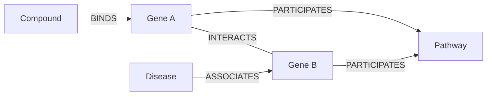
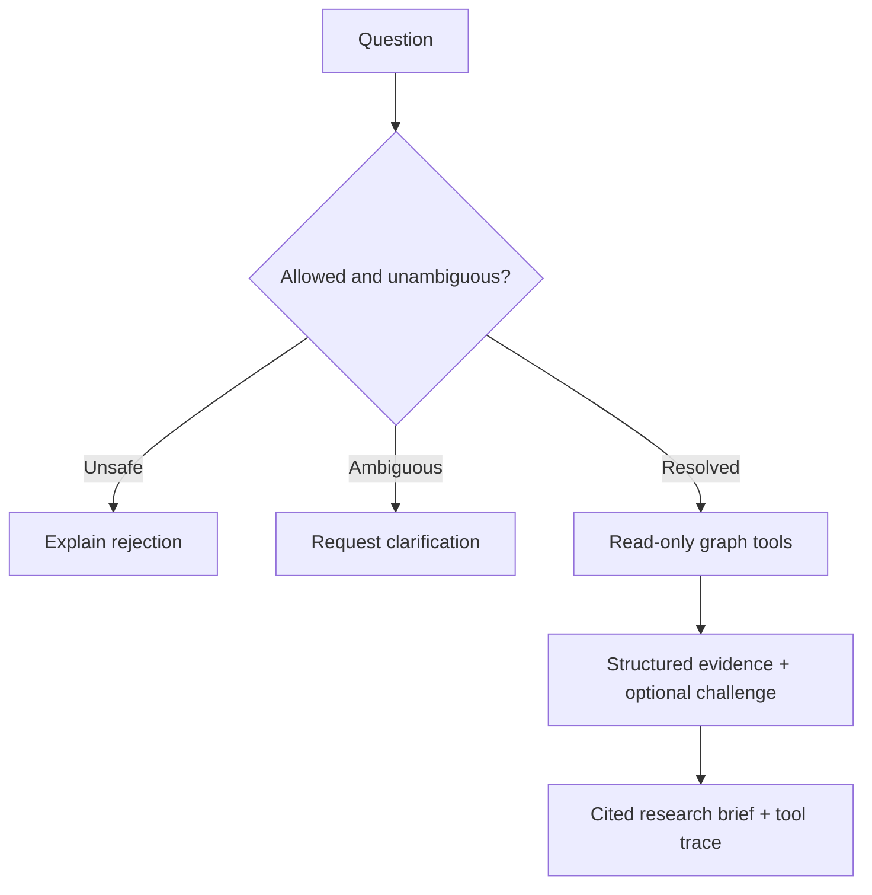

# Architecture and graph schema

## Biological evidence model

All biological nodes also carry a shared entity identity. A `Gene` in Hetionet
represents the corresponding gene/protein concept used by its integrated sources.
`Compound–BINDS–Gene` therefore records binding to the protein encoded by that
gene, rather than claiming that small molecules bind DNA in every such record.

| Entity | Identifier policy | Imported count |
| --- | --- | ---: |
| Compound | `Compound::` plus the original DrugBank identifier | 1,552 |
| Gene | `Gene::` plus the original Entrez Gene identifier | 20,945 |
| Disease | `Disease::` plus the original Disease Ontology identifier | 137 |
| Pathway | `Pathway::` plus the original source identifier | 1,822 |

| Evidence relation | Stored endpoints | Imported count |
| --- | --- | ---: |
| BINDS | Compound → Gene | 11,571 |
| ASSOCIATES | Disease → Gene | 12,623 |
| INTERACTS | Gene → Gene, traversed symmetrically | 147,164 |
| PARTICIPATES | Gene → Pathway | 84,372 |

Counts are recorded in the [manifest](../data/processed/manifest.json). Identity
is never based on a human-readable name. Original attributes, source fields and
available licenses survive preprocessing. A displayed edge ID points to the
retained source record. Missing publication-level citations remain missing;
database provenance is not promoted into a claim of a specific clinical study.

The 755 known treatment pairs are a separate label table. Neither `TREATS` nor
`PALLIATES` participates in predictive features, GDS evidence projections or
displayed biological evidence paths. A known-treatment badge is a factual lookup
against that separate table.

## Three path templates

| Template | Meaning | Maximum length |
| --- | --- | ---: |
| C–G–D | Compound and disease share a gene | 2 edges |
| C–G–G–D | Target and disease-associated gene interact | 3 edges |
| C–G–P–G–D | Distinct target and disease-associated genes share a pathway | 4 edges |

Sparse matrix products count these paths exactly. The pathway count explicitly
excludes the case where both gene positions are the same node. No self-loop
interaction contributes an artificial extra step. Display limits bound graph
visualization and query results without clipping model features.

## Runtime responsibilities

| Component | Responsibility |
| --- | --- |
| Nginx | Serve the interface, reverse-proxy API and documentation, bound request sizes |
| FastAPI | Validate inputs and outputs, enforce limits, expose structured errors |
| Neo4j | Store and query typed evidence with constraints and indexes |
| GDS | Project evidence and compute personalized PageRank and target-neighborhood similarity |
| Graph engine | Compute exact typed-path features, apply the saved model and reconstruct selected-pair scores from its signed terms |
| Binding auditor | Enumerate local binding-deletion envelopes, allocate a global budget across focus and competitors, and return exact bounded ranking certificates |
| LangGraph | Orchestrate entity resolution, retrieval, comparison and explanation |
| LLM provider | Parse the research request into a validated, typed investigation plan |
| Evaluation script | Fix the split, fit preprocessing/model on permitted data and write measured metrics |

## Data flow and reproducibility

The source URL pins a Git commit. The downloader rejects bytes with a mismatched
SHA-256. Preprocessing filters the four node and relationship families, saves the
graph and manifest, and keeps treatment labels separately. Evaluation stores the
actual split identities, selected hyperparameter, model parameters and scores.

The API reports which backend produced its results. A memory engine is useful
for deterministic unit tests and local exploration. The full Compose configuration
uses Neo4j. The exported browser edition identifies its precomputed snapshot and
does not claim to execute live Neo4j or language-model requests.

## Agent control flow

The LLM cannot alter the database, choose benchmark labels or replace model
scores. Query identifiers and relationship choices pass explicit validation.
Relationships are allowlisted, values parameterized, result sizes bounded and
database execution timed out. An unavailable provider is visible in the response
mode rather than disguised as a successful model invocation.

A question can include a disease and a compound independently. A single explicit
compound name overrides an old UI compound selection; multiple names require
clarification. The focused compound determines the evidence paths and exact
assessment. The accompanying candidate list remains the ordered top-K ranking,
so explanatory focus never rewrites the ranked result.

An assessment is computed directly from the graph engine's saved feature
transformations, scaler and coefficients. Baseline and current contributions
reconstruct their respective logits, and the sigmoid reconstructs their scores.
Unsupported pairs retain a diagnostic assessment with no supported rank. The
static exporter records these same assessment objects; it does not approximate
or recompute them in browser JavaScript.

## Binding-audit computation

The auditor snapshots the fitted model and evidence matrices when first needed.
It validates binary binding records, preserves compound-ID tie ordering, and
uses a dedicated fixed-order float64 scorer. This leaves the earlier vectorized
ranking and assessment calculations unchanged.

For a disease, a bounded cache holds local supported score minima/maxima at
deletion counts zero, one and two. The selected compound's minimum score sets a
threshold; each competitor's maximum envelope yields the least cost required to
outrank it. Since binding edge sets are disjoint across compounds, choosing the
cheapest competitor promotions within the remaining global budget is exact.
Loss of support is a separate outcome. The [proof](binding_audit_proof.md) gives
the conditions and attaining-witness construction.

The API and offline verifier recompute the same-algorithm bound in a separate
bounded cache, then independently replay witnesses using edited graph matrices.
The static exporter stores certificates and export-time verification; JavaScript
does not pretend to rerun the optimizer. The scientific tests compare the method
with exhaustive global enumeration on independent tiny graphs.
