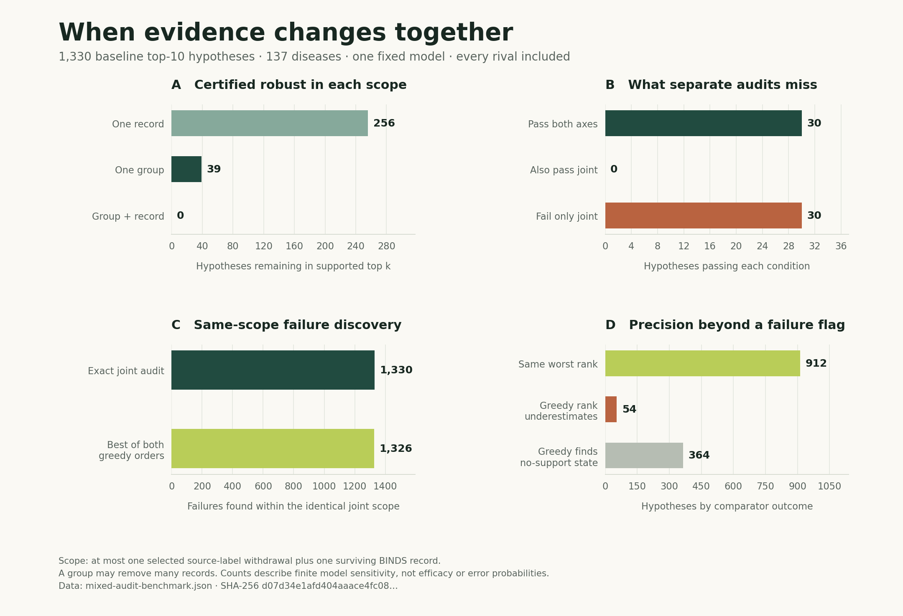

# Mixed evidence audit: executed results

**All 30 candidate–disease pairs that passed both separate checks failed when
the changes were allowed together.** Across the complete 1,330-pair cohort,
the exact joint audit also found four failures missed by the stronger outcome
of both greedy operation orders. These results come from one prepared Hetionet
graph and one frozen model, with every competing compound included.

The evidence is the [complete query-level report](
../reports/v1.4.0/mixed-audit-benchmark.json), its
[checksummed summary](../reports/v1.4.0/mixed-audit-summary.json), and the
[actual execution receipt](../reports/v1.4.0/mixed-reference-execution.json).
The run finished successfully on 1 November 2026 at 22:48:47 UTC. Its source was
clean at both the beginning and end, and every declared check passed.



## Population and exact scope

The protocol processes **all 137 graph diseases** and their canonical baseline
supported top ten, taking fewer when fewer candidates are supported. Three
diseases have no supported candidates; the resulting population contains
**1,330 candidate–disease pairs**. These are pairs, not 1,330 distinct drugs.
All **1,552 compounds** remain eligible as competing candidates under every
edited graph. No treatment labels select perturbations or favorable cases.

The uncertainty rectangle permits at most one withdrawal from all **14 observed
BINDS source labels**, followed by at most one additional surviving BINDS
record. The graph contains **11,571 eligible binding records**. Group membership
uses imported annotations, including overlaps; the residual record must survive
the group withdrawal. A record with missing source annotations remains eligible
for that residual deletion. The fitted model, downstream relations and
`decimal80-binary64-v1` arithmetic stay fixed.

These are universal worst-case statements over a specified finite action set.
A group may remove thousands of records, so a group and an individual record
are different budget units. The experiment assigns no likelihood to a source
withdrawal and does not infer source independence, factual error, treatment
efficacy or biological synergy. See the [method](mixed_audit.md) and
[formal guarantee](mixed_audit_proof.md).

## The complete four-cell result

“Robust” means that every allowed scenario retains support and a rank of at
most ten. A pair is fragile if any allowed scenario loses support or puts it
below the top ten. Support-loss counts are a subset of fragile pairs, not an
additional category to add to that column.

| Group budget | Residual-record budget | Robust | Fragile | Loss of all support attainable |
| ---: | ---: | ---: | ---: | ---: |
| 0 | 0 | 1,330 | 0 | 0 |
| 0 | 1 | 256 | 1,074 | 79 |
| 1 | 0 | 39 | 1,291 | 205 |
| 1 | 1 | 0 | 1,330 | 375 |

Thirty pairs passed **both** one-operation axes; all thirty failed the joint
scope. That is 30/30 among separate-axis survivors and 30/1,330 of the complete
cohort. The remaining nine of the 39 one-group survivors already fail the
one-record axis. Separate audit success therefore leaves a demonstrable gap
for this model, rather than merely a hypothetical gap in the theorem.

For 1,242 pairs, the joint worst supported rank is worse than the maximum of
the two separate-axis bounds. The largest increase is 1,319 rank places.
Another distinct observation is that 170 pairs admit joint loss of all support
when neither separate axis permits support loss. These counts answer different
questions; they are not additional joint-only top-ten failures.

The zero joint-robust count is a property of this broad scope and this fitted
ranker. It does not say that every underlying drug is ineffective or that any
of the imported records is wrong. All counts above are directly aggregated from
the [retained per-query frontiers](../reports/v1.4.0/mixed-audit-benchmark.json).

## A strong, identical-scope greedy comparison

The benchmark runs both operation orders. One greedily chooses a source group
and then optimizes the residual record; the other greedily chooses a record
and then optimizes the group. Their first step uses rank with a rank-boundary
margin tie rule. Both include competitor changes, identical model arithmetic
and the same allowed groups and residual records. The strongest combined
outcome retains whichever order is more damaging for each pair.

| Method | Top-ten or support failures found | Exact failures missed | Supported-rank underestimates / eligible outcomes | Largest supported-rank gap |
| --- | ---: | ---: | ---: | ---: |
| Source first, then optimized record | 1,324 | 6 | 202 / 984 | 1,048 |
| Record first, then optimized group | 1,320 | 10 | 759 / 1,080 | 1,062 |
| Stronger result of both orders | 1,326 | 4 | 54 / 966 | 867 |
| Exact conditional envelopes | 1,330 | 0 | Exact bound | 0 |

The strongest comparator already finds 99.70% of the failures. The additional
four are 0.30% of the full cohort; the experiment does not conceal that small
failure-discovery gap. The exact method additionally supplies an upper bound
and an attaining witness. It is not just another successful attack search.

The supported-rank denominator excludes comparator outcomes with no support:
there is no supported rank to subtract in those cases. For the strongest
comparator, 364 outcomes have no support, 912 attain the exact worst supported
rank, and 54 underestimate it. A rank underestimate is not automatically an
additional top-ten failure. The [full report](
../reports/v1.4.0/mixed-audit-benchmark.json) retains every outcome and both
individual greedy orders, including equal-performing cases.

### Every failure missed by both greedy orders

The following is the entire four-case subset, selected after the completed
cohort. These are illustrations of the measured mechanism, not held-out
validation cases or medical recommendations.

| Pair | Baseline rank | Strongest greedy result | Exact joint result |
| --- | ---: | --- | --- |
| Cytisine / nicotine dependence | 5 | Supported rank 9 | Worst supported rank 9; loss of all support is also attainable |
| Progesterone / prostate cancer | 2 | Supported rank 6 | Worst supported rank 35 |
| Marimastat / thoracic aortic aneurysm | 1 | Supported rank 5 | Worst supported rank 5; loss of all support is also attainable |
| Dasatinib / alopecia areata | 7 | Supported rank 8 | Worst supported rank 41 |

The [complete counterexample bundle](
../reports/v1.4.0/mixed-audit-greedy-counterexamples.json) retains all four
certificates, both greedy outcomes and fresh verification results. Each
regenerated certificate exactly matches its hash in the original full report.
This additional reconstruction verified four certificates and replayed 17
witnesses; it is separately identified and is not folded into the original
benchmark's operation counts.

## An inspectable interaction example

The first interaction in canonical cohort order is Varenicline / nicotine
dependence. Its [standalone certificate](
../reports/v1.4.0/mixed-audit-example-interaction.json) gives:

| Allowed changes | Worst supported rank | Loss of all support attainable? |
| --- | ---: | --- |
| None | 4 | No |
| Any one record | 6 | No |
| Any one source group | 5 | No |
| One group plus one surviving record | 31 | Yes |

The supported-rank witness withdraws `DrugCentral (ChEMBL)` and record
`e_5c45fac211af2dc0e546cff8`, removing 1,837 records across 792 compounds.
The focus retains 92 predictive paths and falls to supported rank 31.
A different allowed witness withdraws `DrugBank (target)` and record
`e_9afe44d562bcf6b84a1126c6`; that scenario removes all supporting paths.
These are separate attaining scenarios, not a claim that one graph state is
simultaneously supported at rank 31 and unsupported.

## Verification, work and observed runtime

The complete run verified 1,330 certificates and all 5,320 requested frontier
cells. It performed 5,560 certificate-witness replay operations and 2,455
greedy-witness replay operations. It checked 3,990 greedy outcomes. All reported
checks passed, and scientific source bytes, input bytes, the fitted model and
legacy explorer scores remained unchanged. Replay counts are operations across
queries, not counts of independent experiments or unique edited graphs.

For each disease, the default joint action set has 159,259 action
representations. The conditional table has 15 slices and evaluates 182,524
local compound states. Those units differ: one local-state score is not one
complete-world reranking, and different action representations can produce the
same edited graph. Their ratio is not a speedup measurement.

The benchmark timer recorded **1,017.741 seconds** after shared `GraphEngine`
loading, including auditor initialization, cohort construction, all exact
verification and both greedy orders. The outer process receipt recorded
**1,026.451 seconds** including Python startup and graph loading, with exit
code zero. This is one complete workload on a shared machine, not an isolated
query-latency estimate. The largest compact certificate was 23,280 bytes.

The separate [executed scaling study](mixed_scaling.md) measures conditional
envelopes against literal complete-world recomputation on 24 synthetic graphs
with three trials per graph, retaining setup and verification separately.
It addresses computation on that explicit small family; it does not extrapolate
this reference run to arbitrary graph sizes or learned GNNs.

## Source identity and replay

The clean measured checkpoint is
`3f14898bdcc85147ec577287daea7240dae9ec30`. The exact
[source archive](../reports/v1.4.0/reference-source-3f14898.tar.gz) and its seven
scientific module hashes are identified in
[mixed-reference-source.json](../reports/v1.4.0/mixed-reference-source.json).
The archive is also retained in the release verification material; the local
Git checkpoint is not represented as a public GitHub commit. Scientific module
bytes match the implementation even though the full application source has
additional interface, API and packaging changes.

| Identity | SHA-256 / contract |
| --- | --- |
| Full benchmark report | `d07d34e1afd404aaace4fc083ecd9f5c9b872256613378dad338fdc2487f675e` |
| Prepared graph bytes | `2371c391ba7b7103a9fba9c3232e61da9ff7338f214148d2947704e52fd057b0` |
| Model semantic identity | `311897fb3678a7885b8ddb7d63becfe990860bfb3c39cb6195166bad531d14f3` |
| Model file bytes | `266370f46df03d4b3554f4441e336c19e53d4ca74ec00aaff3a16b684dcecc70` |
| Declared arithmetic | `decimal80-binary64-v1` |

The model's semantic identity and its file checksum have different roles and
are intentionally recorded separately. Figures are rendered directly from the
complete report, with source, renderer and image checksums in the
[figure manifest](../reports/v1.4.0/mixed-audit-figure-manifest.json).

From the matching source and data, reproduce a standalone example with:

```bash
python -m scripts.verify_audit \
  reports/v1.4.0/mixed-audit-example-interaction.json \
  --data-dir data/processed --output /tmp/ariadne-mixed-verification.json
```

To independently verify all four bundled greedy counterexamples:

```python
import json
from pathlib import Path
from app.graph_engine import GraphEngine
from app.mixed_audit import MixedAuditor

path = Path("reports/v1.4.0/mixed-audit-greedy-counterexamples.json")
auditor = MixedAuditor(GraphEngine(Path("data/processed")))
for example in json.loads(path.read_text())["examples"]:
    certificate = example["certificate"]
    result = auditor.verify(certificate)
    assert result["valid"], result["errors"]
    print(certificate["compound"]["name"], result["status"])
```

The [reference inventory](../reports/v1.4.0/README.md) describes preparing the
pinned graph while preserving the supplied model. Fresh runs have new timings
and timestamps. Do not refit and silently substitute a different model for
verification of these retained certificates.

## Research claim and limits

The supported claim is a specialized exact decomposition for interacting
annotation-union and residual-record withdrawals, with independently replayable
finite-arithmetic witnesses and a measured failure of separate-axis reasoning.
The theorem and the broader group-budget complexity boundary are explicit in
the [proof](mixed_audit_proof.md). The
[prior-art comparison](research_atlas.md) acknowledges existing graph
certification, mixed-perturbation certification and uncertain-ranking research.

This complete cohort is one dataset and one frozen path model. The selected
examples are post hoc. Small allowed budgets and a bounded group catalogue
are substantive parts of the guarantee. The results establish neither broad
empirical generalization nor clinical validity, commercial demand or acceptance
at a particular research venue.
