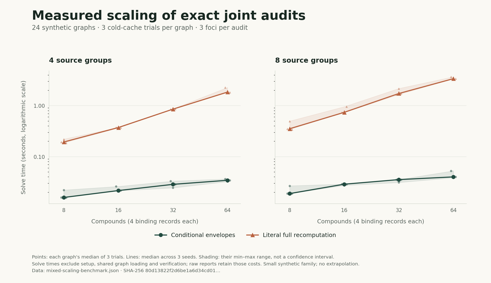

# Measured scaling against complete-world recomputation

The synthetic scaling study asks a narrow computational question: **how long do
conditional envelopes take, compared with independently rebuilding and ranking
every allowed edited graph, for exactly the same three audit queries?** It does
not measure biomedical accuracy or compare ARIADNE with a learned GNN.

The study implementation is
[`scripts/benchmark_mixed_scaling.py`](../scripts/benchmark_mixed_scaling.py).
The main Hetionet experiment remains a separate
[complete-cohort benchmark](mixed_audit.md).

## Protocol fixed before execution

| Dimension | Predeclared values |
|---|---|
| Compounds | 8, 16, 32, 64 |
| Observed source groups | 4, 8 |
| Seeds | 101, 202, 303 |
| Trials | 3 per dataset; all 24 datasets retained |
| Other entities | 16 genes, 4 pathways, 1 disease |
| Binding degree | Exactly 4 distinct target genes per compound |
| Annotation behavior | Some missing labels; some records belong to overlapping groups |
| Model | Fixed signed coefficients, seeded means/scales, fixed intercept; no training |
| Focus cohort | All three canonical baseline top-3 compounds |
| Threat rectangle | `(0,0)`, `(0,1)`, `(1,0)`, `(1,1)` group/record budgets |
| Scorer | The same `decimal80-binary64-v1` finite arithmetic contract |

NumPy's explicit PCG64 generator constructs the data. The retained graph, model,
manifest and evaluation-marker bytes are SHA-256 identified; subsequent replay
can use those bytes without relying on a random-number generator implementation.
Every candidate, including competitors, participates in each rank computation.
A residual binding record must survive the preceding group withdrawal.

The generator creates synthetic entities and synthetic source annotations.
There are no treatment labels or imported clinical records in this experiment.

## Fairness and measurement boundaries

Both methods share the same loaded `GraphEngine` and the same independently
selected baseline cohort. Shared graph-loading and cohort-selection wall times
are recorded separately.

Each timed method starts with a fresh solver and empty scalar `log1p`, square-root
and sigmoid caches. Method order alternates by dataset index plus trial index;
one method cannot inherit the other method's numerical cache. Natural cache
reuse **within** a method's workload remains enabled for both implementations.

The **envelope method** builds its conditional slices once and issues three
complete certificates. The **literal reference** enumerates every group/no-group
choice and every surviving record/no-record choice. For each action it edits a
fresh sparse binding matrix, recomputes all three full path products, scores and
reranks every compound, then updates all three focus frontiers together.
It does not repeat the complete enumeration independently for each focus.

The reference independently implements path products and rank ordering. It does
not call the envelope solver, production rank helper, contribution table, or
production matrix replay. Sharing the declared scalar scoring kernel keeps the
numerical problem identical. Additional tests compare this sparse reference
with literal path enumeration and separately written scalar Decimal arithmetic.

Each raw trial records:

- Solver setup and solve times for both methods.
- Independent verification time, excluded from solve ratios.
- All three certificate hashes and the complete-world action count.
- Number of compared frontier cells, verified certificates and independently
  replayed matrix witnesses.

The summary includes paired naive/envelope ratios for both **solve alone** and
**setup plus solve**, with minimum, median and maximum over the nine trials in
each compound-count/group-count setting. These are ratios of measured wall
times. Action representations and local states are different work units and
their ratio is never presented as a runtime speedup.

## Correctness gates

Every trial must agree exactly with exhaustive enumeration on worst supported
rank, attainable loss of support, top-3 robustness and the number of permitted
action representations for **every one of the four cells and three foci**.
All certificates must pass the production verifier. Every emitted witness is
also reconstructed with the independent reference's full sparse products,
including before/after counts, scores, logits, support and rank. No tolerance is
used. Certificates must be identical across repeated trials.

The experiment checks source-file hashes before and after execution and checks
all retained input hashes again at the end. A caught failure or keyboard
interrupt replaces both result manifests with an explicit failure status.
Abrupt process termination may leave the initial `running` status; that must
never count as completed evidence. A partial grid is labeled as such and cannot
claim the fixed full protocol.

## Completed reference run

The complete fixed study passed on **1 November 2026**, using clean source
checkpoint `54da143b57d64717bb082fa3606776b3f6ab0db5`. It compared **864 frontier
cells**, verified **216 certificates** and independently reconstructed **864
emitted matrix witnesses** across **24 datasets and 72 trials**, with zero
failed checks. Study wall time was **99.18 seconds**, including generation,
shared loading, both methods and verification. The main Hetionet experiment had
finished before this timed study started; other system workload was not controlled.

The recorded environment was Python 3.12.14, NumPy 2.3.5, SciPy 1.17.0 and Linux
x86-64. The source tree was clean at both ends and all scientific source and
retained input hashes were unchanged.

| Compounds | Groups | Envelope solve, median ms | Literal solve, median ms | Paired solve ratio | Paired setup + solve ratio |
|---:|---:|---:|---:|---:|---:|
| 8 | 4 | 15.9 | 187.4 | 12.0× | 10.9× |
| 8 | 8 | 19.4 | 392.6 | 20.7× | 18.9× |
| 16 | 4 | 23.4 | 373.7 | 16.0× | 13.2× |
| 16 | 8 | 28.8 | 752.1 | 27.5× | 24.9× |
| 32 | 4 | 25.8 | 857.8 | 33.9× | 27.4× |
| 32 | 8 | 34.6 | 1,713.6 | 49.1× | 41.9× |
| 64 | 4 | 34.4 | 1,861.0 | 55.9× | 44.1× |
| 64 | 8 | 40.1 | 3,383.9 | 84.8× | 71.0× |



The plot first takes each seed's three-trial median, then shows the median and
descriptive minimum–maximum range across the three seeds. The shading is **not
a confidence interval**. Its
[figure manifest](../reports/v1.4.0/scaling/mixed-scaling-figure-manifest.json)
binds the exact report and renderer source hashes; the
[SVG version](../reports/v1.4.0/scaling/mixed-scaling-results.svg) is available
for export.

Every row contains three seeds with three timed trials each. Ratios are the
median of the nine **paired** literal/envelope ratios, so they need not equal
the ratio of the displayed marginal medians. Both methods solve the same
three-compound workload. Shared load/cohort time and independent verification
are excluded from the ratios. The full summary retains each ratio's observed
minimum and maximum, and the full report retains every raw trial.

The exact construction therefore had lower setup-plus-solve wall time in this
measured family. This is an implementation-level comparison with the stated
literal reference, not a general complexity or clinical-performance claim.
Changing compound count also changes the seeded draw sequence for subsequent
graph/model generation; these are generated instances rather than a nested
graph with every other numeric input held fixed.

Evidence:

- [Complete raw report](../reports/v1.4.0/scaling/mixed-scaling-benchmark.json).
- [Checksummed summary](../reports/v1.4.0/scaling/mixed-scaling-summary.json).
- [Actual process receipt](../reports/v1.4.0/scaling/execution.json).
- [Frozen source archive](../reports/v1.4.0/scaling/scaling-source-54da143.tar.gz).
- [Exact replay inputs](../reports/v1.4.0/scaling/mixed-scaling-replay-inputs.zip):
  all 96 graph, model, manifest and evaluation-marker files, preserving their
  `inputs/cNNNN-gNN-sSEED/` paths. Each uncompressed file is identified by the
  corresponding dataset's `input_file_sha256` in the full report.

The full-report SHA-256 is
`80d13822f2d6be1a6d34cd0155bfbc50433c345d619dc6a3ebd33454fcc95599`.
The source-archive SHA-256 is
`30690700500c774beda4014c2878652a8bd206af6b61d58fdc7d330be600f623`.

The repository distributes the reference inputs in one ZIP; the CI evidence
artifact retains the generated input directories directly. To restore the
reference input directories from the repository root:

```bash
python -m zipfile -e \
  reports/v1.4.0/scaling/mixed-scaling-replay-inputs.zip \
  reports/v1.4.0/scaling
```

## Reproduce

Run from a clean checkout of the source revision, with the project's pinned
dependencies installed. Keep measured outputs outside that checkout so output
generation does not dirty its source identity:

```bash
python -m scripts.benchmark_mixed_scaling \
  --require-clean \
  --output-dir /tmp/ariadne-mixed-scaling
```

The fixed default CLI executes the complete grid. It writes:

- `mixed-scaling-benchmark.json`: complete protocol, source identities, raw
  matched timings, exact results and the first trial's certificates per dataset.
- `mixed-scaling-summary.json`: aggregate results and a checksum of the full report.
- `inputs/cNNNN-gNN-sSEED/`: the actual graph, model, manifest and evaluation
  marker for each generated dataset.

The tests use a reduced grid for fast regression coverage and explicitly mark
those reports as partial. Run them with:

```bash
python -m pytest tests/test_mixed_scaling.py -q
```

## What the measurements can establish

This experiment establishes correctness and observed runtime on the stated
small synthetic family and recorded environment. Fixed degree, one disease and
only four compound counts do not identify an asymptotic exponent or prove a
Hetionet-scale latency claim. Python implementation costs and certificate
serialization are included in the envelope solve. The reference is a transparent
literal exhaustive implementation, not a claim to be the fastest possible
exhaustive solver. Timings on a shared machine are subject to scheduling noise;
all raw trials remain visible and none are discarded.

Results belong to their measured source revision and input hashes. The completed
reference result above does not imply that a later rerun has passed.
