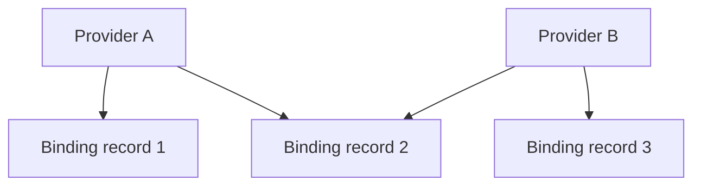

# Audit correlated evidence withdrawals

Version 1.3 asks a different question from the individual-record audit:

> Would this model-based shortlist survive if every binding record mentioning
> one or two selected providers or imported PubMed identifiers were quarantined?

Many graph records can share a provider or citation. Withdrawing such a group
can change the selected compound and many competitors at the same time. The
auditor enumerates every permitted group subset, recomputes all compound scores
jointly, and reports the exact worst supported rank and whether all supporting
paths can disappear. The model, candidate universe and other relationship
families remain fixed. The [proof](provenance_audit_proof.md) defines the finite
guarantee and the declared numerical contract.

## What a group means

| Catalogue | Imported annotation | Selection |
| --- | --- | --- |
| Provider | The preserved `sources` list on a BINDS record | All 14 observed binding-provider labels by default; an explicit subset is allowed |
| PubMed | The preserved `data.pubmed_ids` list on a BINDS record | An explicit selection of 1–16 observed identifiers |

Only BINDS records enter this catalogue. Provider labels elsewhere in the graph
do not become eligible binding groups. Missing annotations remain missing and
are counted in catalogue coverage. A PubMed link is an imported identifier; the
application does not infer that it represents exactly one experiment, a clinical
trial, an independent replication or the full contents of a publication.

The operation is **conservative record quarantine**. Selecting a group removes
every binding record that mentions it, even when the same record has additional
provider or PubMed annotations. The data do not establish that each annotation
independently supports the complete consolidated relation. The application
therefore does not invent an independent-evidence rule to keep it alive.



Withdrawing A removes records 1 and 2. Withdrawing B removes records 2 and 3.
Withdrawing both removes three records, not four. Assuming A cannot be withdrawn
does not protect record 2 from a permitted withdrawal of B.

These are stress scenarios, not assertions that a provider is unreliable or that
a cited paper has been retracted. No probability is assigned to a withdrawal.

## Reading a certificate

The certificate binds the graph, dataset, fitted model, group membership map and
scorer identities. It records the exact selected catalogue, any protected groups,
top-k threshold and withdrawal budget. At most two groups can be withdrawn; at
most 16 groups can be selected. All 14 default provider groups give 106 subsets
through budget two, including the empty baseline. This scenario count is not a
performance comparison with individual-edge auditing: a provider can withdraw
many records at once, so the perturbation spaces are different.

For every budget from zero to the requested maximum, inspect:

- **Worst supported rank:** the largest numerical rank while at least one
  supporting path remains, with a group subset attaining that rank.
- **Support loss:** a separate result and witness if no supporting path remains.
  An unsupported diagnostic score is never treated as a successful rank.
- **Robustness:** every permitted state retains support and rank at most k.
- **Witness scope:** the removed-record count, a digest of the complete ordered
  record IDs, the number of affected compounds and a bounded record preview.
  A truncated preview is never presented as the complete removal set.

The certificate also summarizes the original top-k shortlist. The display is
bounded to its first 20 entries and explicitly reports truncation for larger k.
The selected compound's audit remains exact throughout the supported k range.

## Conditional protection plans

For a fixed audit, a failing scenario is a permitted group subset that removes
the compound from the shortlist or removes all its support. The planner finds
the **smallest number of additional selected groups** that must be assumed
unavailable for withdrawal to block every failing scenario. It reports the exact
number of optimal sets, one representative and up to 12 alternatives. These are
minimum-cardinality sets; they are not merely inclusion-minimal suggestions.

This is a bounded hitting-set computation, not a new general-purpose optimizer.
Protecting a group changes the declared scenario space; it does not add evidence
or alter the original graph. The resulting guarantee is conditional on the
protected-group assumptions. A completed review does not automatically justify
those assumptions, and records shared with an unprotected group remain exposed.

If the baseline already fails the chosen top-k threshold, no group protection can
repair it: the empty withdrawal scenario still fails. The result says
`impossible_baseline`. If every permitted scenario already passes, zero additional
groups are required. Neither result is hidden by a favorable witness.

## Verification and reproducibility

Export the complete certificate and use the matching source, graph and model:

```bash
.venv/bin/python -m scripts.verify_audit provenance-certificate.json \
  --data-dir data/processed --output provenance-verification.json
```

The verifier recomputes the full scenario table, bounds, shortlist summaries and
protection optimum. It separately replays distinct witness group sets by editing
a copy of the binding matrix and rebuilding path counts. The optimality
recomputation uses the same exhaustive algorithm; the tests additionally compare
with independent tiny-graph enumeration. A matching hash or one valid witness
alone does not prove the bound or the protection optimum.

The browser-only research edition displays recorded export-time results. It does
not recompute the optimizer, replay a live graph or authenticate the author of a
content hash. Raw asset checksums detect inconsistent files against the served
manifest. Use the offline verifier or live API for computation.

Run `make benchmark-provenance` to produce the complete provider workload and
the explicitly scoped illustrative citation case. The benchmark evaluates all
diseases, includes every compound as a competitor, and retains negative results.
Examples chosen after inspecting results are labelled as illustrations, not an
independent validation cohort. See `reports/v1.3.0/` for the measured outputs.

## Measured reference workload

The [complete provider benchmark](../reports/v1.3.0/provenance-audit-benchmark.json)
and [compact summary](../reports/v1.3.0/provenance-audit-summary.json) cover all 137
diseases and 1,330 original supported top-ten entries. Three diseases have no
supported candidates. Every compound remains eligible as a competitor.

| Permitted provider withdrawals | Robust top-ten entries | Fragile entries | Support loss attainable |
| --- | ---: | ---: | ---: |
| At most one | 39 | 1,291 | 205 |
| At most two | 4 | 1,326 | 535 |

Of the 104 entries robust to any two individual BINDS deletions, 102 are fragile
under up to two provider-group withdrawals. This does not invalidate the earlier
certificate: one provider label can annotate thousands of edges. The two audits
answer different questions about different perturbation spaces.

The strongest tested frequency-greedy protection comparator, followed by removal
of redundant choices, matches the exact minimum cardinality on all 1,330 queries.
**No protection-set size improvement over that comparator was observed.** The
exact method establishes optimality and counts every optimum; 165 queries have
multiple optimal protection sets. The benchmark separately rechecked 1,330
certificates, replayed 4,168 witnesses and checked 2,660 exact/greedy protection
reruns with zero failures. These are model-audit results, not clinical outcomes.

Two postselected illustrations make the scope tangible:

| Illustration | Individual-edge result | Correlated-group result |
| --- | --- | --- |
| [Marimastat / rheumatoid arthritis](../reports/v1.3.0/provenance-audit-example-source.json) | Remains first under any two individual binding-record deletions | Withdrawing the DrugBank target annotation group permits rank 1,096; up to two provider withdrawals can also remove all support |
| [Crizotinib / Paget's disease of bone](../reports/v1.3.0/provenance-audit-example-pubmed.json) | Baseline eighth; worst rank ninth under any two individual binding-record deletions | Quarantining records mentioning imported PMID 22037378 permits rank 1,015; this example selects exactly that one PMID group |

The [size-matched random control](../reports/v1.3.0/provenance-size-matched-controls.json)
uses 1,000 fixed-seed draws per disclosed illustration with the same number of
globally removed binding records as the group witness. It helps distinguish the
observed concentration from arbitrary deletions of that size. These cases were
selected after exploration, so this descriptive control does not establish a
general predictive advantage, a calibrated error rate or a causal claim.
The matching is on global record count, not the focal compound's lost binding
degree or biological targets: the named source/PMID groups are more concentrated
on the illustrated compound. Zero observed failures in a finite control sample
would not imply zero failure probability.

## Scientific and product limits

This release does not cover unselected groups, missing annotations, shared
downstream relation withdrawals, new evidence, refitting, dose or biological
interventions. A stable model ranking can still be wrong. A conditional
protection set is not an optimal human-review schedule or an experiment-selection
policy: no review costs, uncertain review outcomes or laboratory observations
were supplied to this optimizer.

The capability is a concrete extension of the research workbench. It is not a
claim of first-in-the-world provenance analysis, clinical validation or a ready
enterprise data-ingestion system. The [prior-art comparison](research_contribution.md)
and [commercial pilot protocol](commercial_pilot.md) state the claims that remain
to be tested.
