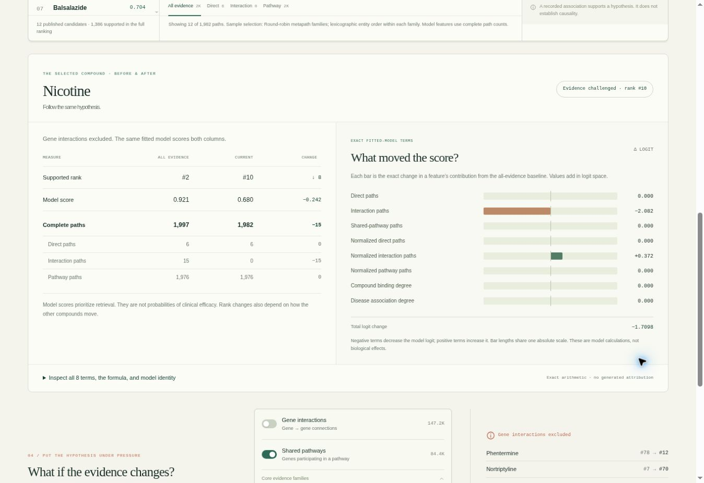

# ARIADNE 1.1 — local verification

This release adds exact selected-compound explanations and makes
first-run and verification behavior more reliable. Its biomedical dataset,
training split, saved scoring model and retrospective benchmark are unchanged.
The baseline is the published
[1.0 release](https://github.com/Azzbee/ariadne-bio/releases/tag/v1.0.0), from commit
`27f735ae9d0487ffd8c1fc3c740c2a7f99910893`.

This page records **local verification** and the implemented behavior. The
[CI workflow](https://github.com/Azzbee/ariadne-bio/actions/workflows/ci.yml) is the
authoritative per-commit record of hosted checks. Immutable successful-run links,
release source identities and registry verification belong to the published
release assets and notes; local results do not substitute for those records.

The image is a real capture of the updated interface. Browser verification also
checked a shared Dextromethorphan case outside the displayed top-K (rank 13),
Isoflurophate retained after restoring all evidence (rank 31), an unsupported state with null rank, removal
of a stale agent brief, and an actual exported assessment.

## What changes

- **Exact score assessment.** A selected compound has an all-evidence baseline
  and current scenario, with all eight transformed features, saved means/scales,
  coefficients and signed logit contributions. The same model supplies both
  scores. The API exposes this through `/api/assessment/{disease_id}/{compound_id}`.
- **Persistent compound focus.** The interface retains the selected pair when
  its rank changes or all supporting paths disappear. An unsupported pair has a
  diagnostic score and no supported rank. Recorded snapshot assessments use the
  same engine objects as the live API.
- **Compound-aware agent.** An explicitly named compound overrides stale UI
  focus. Its evidence and assessment are returned alongside the correctly
  ordered ranking context. The provider still cannot manufacture model scores.
- **Interaction reliability.** Updated frontend state handling protects the
  selected investigation during asynchronous loading and supports the added
  explanation controls.
- **Verified local model identity.** Startup reuses the default Qwen model only
  when its full manifest digest matches the pinned reference. It pulls an absent
  model once, then checks its identity. An existing mismatch is not overwritten.
  Custom unpinned models are identified honestly as such.
- **Fresh operational evidence.** Quality and integration each discard only
  their own previous generated outputs immediately after checkout. Separate run
  contexts prevent historical success files from being uploaded as new results.
  Frontend security headers are retained correctly under Nginx inheritance.

The [API contract](../api.md), [model card](../model_card.md),
[deployment guide](../deployment.md) and [release procedure](../releasing.md)
describe these boundaries and how to reproduce them.

## Local verification

These are measured local results for the current development pass, not claims
about a hosted CI run or published package:

| Check | Result |
| --- | --- |
| Python unit/API suite | 181 passed |
| JavaScript suite | 45 passed |
| Python branch-aware coverage | 83.91% |
| Pylint | 10.00/10 |
| Black | Clean |
| Focused infrastructure suite | 15 passed, included within the Python work; default-model reuse/mismatch/missing/custom behavior and scoped CI cleanup verified |
| Complete updated notebook | All 19 cells executed, including 9 code cells; outputs saved in `demo.ipynb` |
| Historical score regression | 3,401,984 scores across all 16 exclusion configurations; identical float64 bytes; maximum difference 0.0 |

The [unit/API report](../../reports/v1.1.0/unit-junit.xml),
[frontend report](../../reports/v1.1.0/frontend.tap), and
[coverage report](../../reports/v1.1.0/coverage.json) retain the measured results.
The [score regression report](../../reports/v1.1.0/score-regression.json) binds the
data, model, old and new engine implementations, and verifier to their exact
checksums. Reproduce it with `make verify-scores` after preparing the data. A
shallow clone must first obtain history containing the published v1.0.0 commit;
the verifier never fetches or refits silently.

The model initializer's expected default digest was independently checked against
the public Ollama manifest. CI separately verifies the actual installed-model identity and the complete
Docker path. A registry lookup or mocked test does not by itself establish
successful runtime model verification.

## Executed explanation example

The updated [notebook](../../demo.ipynb) follows Nicotine and Alzheimer's disease
with exactly the same fitted model before and after removing `INTERACTS`:

| Quantity | All evidence | INTERACTS excluded |
| --- | ---: | ---: |
| Supported rank | 2 | 10 |
| Retrieval score | 0.921462 | 0.679738 |
| Logit | 2.462383 | 0.752566 |
| Supporting paths | 1,997 | 1,982 |

The logit changes by **−1.70981631** and the score by **−0.24172463**. The notebook
tabulates all eight terms and checks each standardized coefficient contribution,
both logit reconstructions, both sigmoid scores and the summed logit change
within `1e-12` absolute tolerance. It also checks the retained unsupported
assessment after removing `BINDS`.

Terms are measured relative to the training-feature means. They add in logit
space, and an absent feature may have a nonzero term. This is an explanation of
the saved model's arithmetic; it is not a causal biological effect or a
probability of clinical efficacy.

## CI and release evidence

The configured CI starts from the checked-out source revision and retains
separate quality and integration contexts. Quality compares all scores with the
checksum-verified v1.0.0 implementation. Its integration job runs the complete
`make docker-run` path, verifies the fresh default-model identity, checks HTTP
assessment and response headers, exercises genuine Neo4j/GDS operations, and
runs all four live-provider tests. The selected-compound case deliberately
supplies stale UI focus. Deterministic fallback does not satisfy an LLM success
assertion.

Main image publication depends on successful quality and integration jobs. The
release procedure independently verifies anonymous image retrieval and matches
source/revision labels to the release commit. Research ZIPs are built from the
corresponding frontend and recorded assessments with licenses and checksums.
Earlier videos, snapshots and evidence retain their actual version identity.
See the [workflow runs](https://github.com/Azzbee/ariadne-bio/actions/workflows/ci.yml)
and published release notes for the immutable results of a particular commit.
