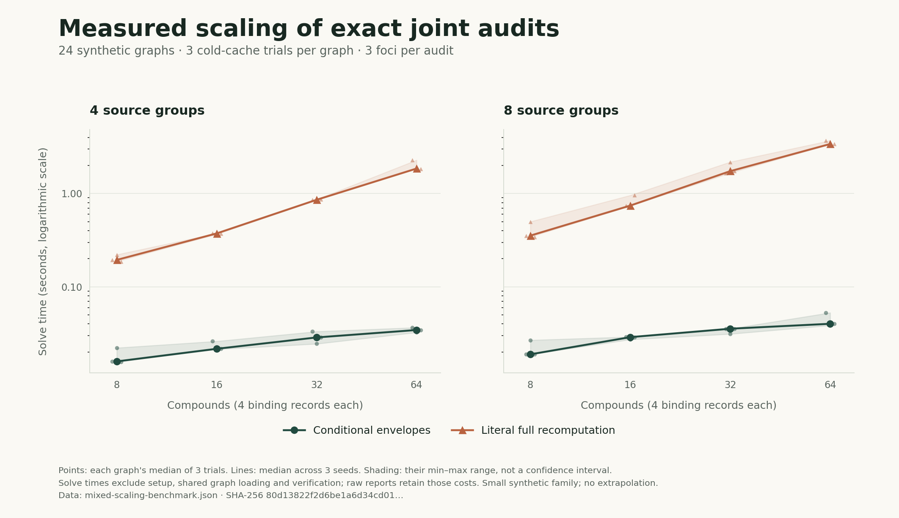

# Executed synthetic scaling study

The [complete report](mixed-scaling-benchmark.json) and
[summary](mixed-scaling-summary.json) retain all **24 generated graphs and
72 timed trials**. The run verified 216 certificates, compared 864 frontier
cells and independently replayed 864 emitted witnesses, with zero failed
checks. Exact source checkpoint:
`54da143b57d64717bb082fa3606776b3f6ab0db5`.



The eight settings had median paired literal/envelope solve-time ratios of
12.0–84.8×, or 10.9–71.0× including each method's setup. These are measured
ratios for this small synthetic family and literal exhaustive implementation.
They do not establish a general speedup, a fitted asymptotic exponent or
Hetionet-scale latency. All raw observations remain available. The plot shows
per-graph trial medians and descriptive ranges across seeds, not confidence
intervals; its statistic differs from the pooled paired-ratio summary.

| Artifact | Meaning |
| --- | --- |
| `mixed-scaling-benchmark.json` | Fixed protocol, raw paired timings, first-trial certificates, coverage and source/input hashes |
| `mixed-scaling-summary.json` | Aggregate timings and the full report checksum |
| `execution.json` | Actual command, scheduling, start/finish times and process outcome |
| `mixed-scaling-replay-inputs.zip` | Exact graph, model, manifest and evaluation-marker bytes for all 24 datasets |
| `mixed-scaling-replay-inputs-manifest.json` | Checksums verifying all 96 ZIP payloads against the measured report |
| `mixed-scaling-offline-replay.json` | Fresh extraction and verification of all 96 input files, 72 retained certificates and 276 distinct-within-certificate matrix witnesses |
| `mixed-scaling-results.svg` / `.png` | Actual measured figure in vector and raster formats |
| `mixed-scaling-figure-manifest.json` | Report, renderer, plotted descriptive values and image hashes |
| `scaling-source-54da143.tar.gz` | Exact clean source checkpoint used for the timed run |

The full report SHA-256 is
`80d13822f2d6be1a6d34cd0155bfbc50433c345d619dc6a3ebd33454fcc95599`.
The [source archive](scaling-source-54da143.tar.gz) preserves the actual measured
checkpoint even when the application is published through different GitHub
commits. The [protocol and interpretation](../../../docs/mixed_scaling.md)
state the cache policy, method order, timing boundaries and limitations.

## Replay the retained inputs

From the project root, extract the [input archive](mixed-scaling-replay-inputs.zip):

```bash
python -m zipfile -e \
  reports/v1.4.0/scaling/mixed-scaling-replay-inputs.zip \
  /tmp/ariadne-scaling-replay
```

The following verifies the 72 retained first-trial certificates. The original
study repeats those certificates across three trials, accounting for its 216
verification operations.

The documented ZIP replay was executed successfully: all 72 certificates
verified, with 276 matrix-witness replay operations and zero failed checks.
Its [separate receipt](mixed-scaling-offline-replay.json) is not part of the
original timed benchmark.

```python
import json
from pathlib import Path
from app.graph_engine import GraphEngine
from app.mixed_audit import MixedAuditor

report = json.loads(Path(
    "reports/v1.4.0/scaling/mixed-scaling-benchmark.json"
).read_text())
inputs = Path("/tmp/ariadne-scaling-replay/inputs")
for dataset in report["datasets"]:
    auditor = MixedAuditor(GraphEngine(inputs / dataset["dataset_id"]))
    for certificate in dataset["certificates"]:
        verdict = auditor.verify(certificate)
        assert verdict["valid"], verdict["errors"]
```

To repeat the timed experiment, use the retained source with the pinned project
dependencies and run `python -m scripts.benchmark_mixed_scaling --require-clean
--output-dir /tmp/ariadne-mixed-scaling`. This regenerates the fixed grid and
collects new timings; it does not substitute those timings into the retained run.
